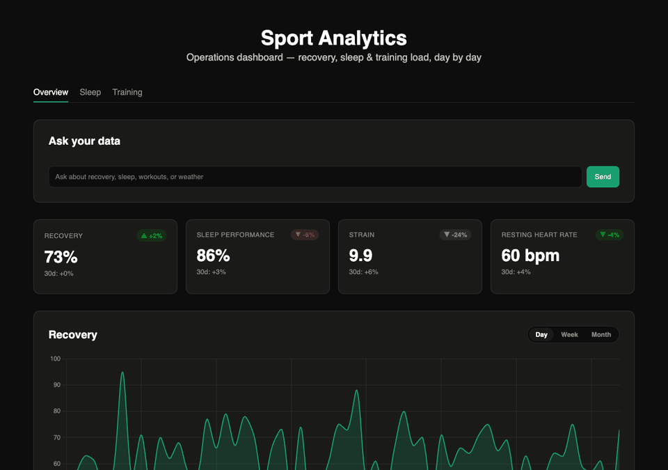
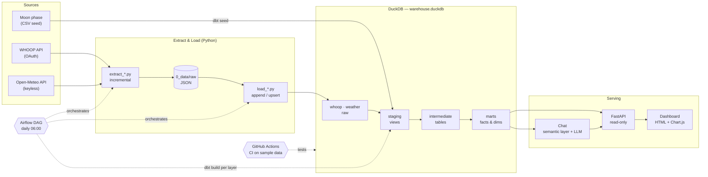
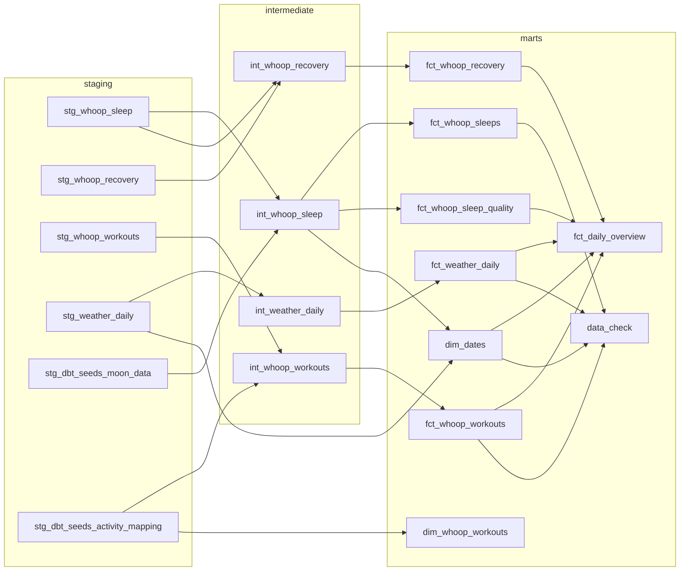
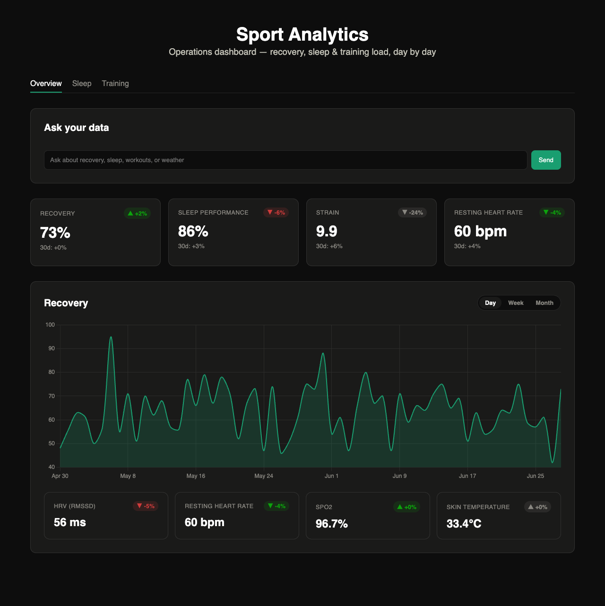
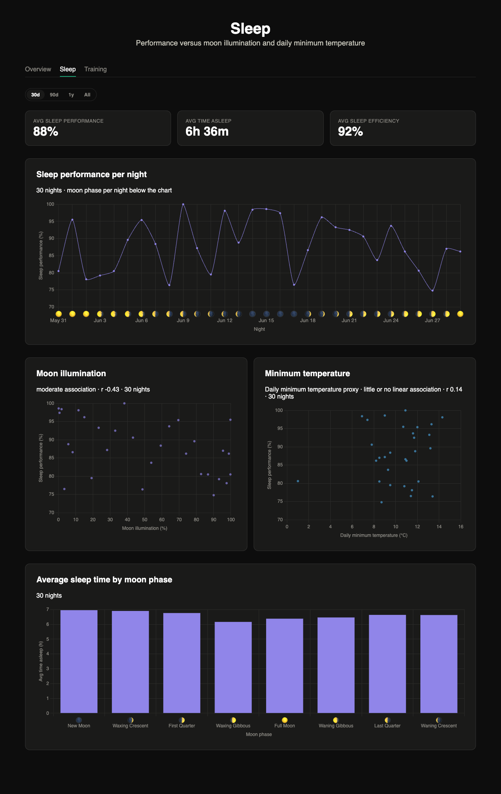
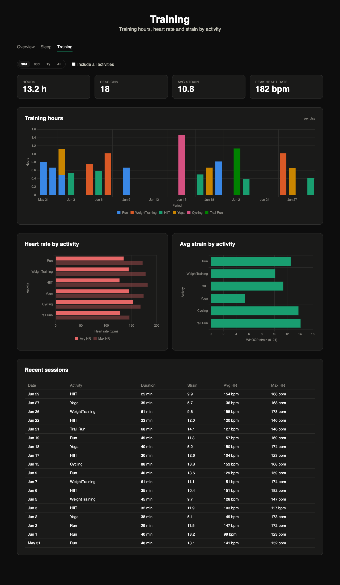

# Sport Analytics — WHOOP, Weather & Moon Phase

[](https://github.com/MaxLate/sport-analytics-pipeline/actions/workflows/ci.yml)


An end-to-end analytics engineering project: WHOOP fitness data and local weather are extracted from their APIs, loaded into DuckDB, modelled with dbt into a Kimball-style star schema, orchestrated daily with Airflow, and served through a FastAPI backend to a three-page dashboard with a semantic-layer chat ("Ask your data").



> All screenshots show **synthetic sample data** (`load_sample_data.py`), not personal health data.

## ✨ Highlights

- **Full ELT, one warehouse:** incremental API extracts → raw JSON → DuckDB raw schemas → dbt staging / intermediate / marts, all in a single DuckDB file with one schema per layer.
- **Dimensional modelling:** fact tables per source, a date dimension, and a cross-source `fct_daily_overview` (one row per day: recovery, sleep, training, weather, moon phase).
- **Data quality as a gate:** 116 dbt tests (uniqueness, not-null, accepted values, relationships) run inside `dbt build`. A failing test stops the downstream layers in Airflow.
- **Source-aware loading:** WHOOP records are immutable, so loads are append-only with skip-existing. Open-Meteo revises recent days, so weather is upserted by date over a lookback window.
- **Orchestration:** Airflow DAG (docker-compose) with parallel extracts and a layer-by-layer `dbt build`. A `PIPELINE_MODE=sample` switch runs the whole DAG without credentials.
- **Semantic layer + LLM chat:** a YAML semantic layer in dbt semantic-model shape. Metric questions compile deterministically to SQL, and open questions go to local LLM agents. Every query is parsed and guarded as a read-only `SELECT`. The LLM path is still work in progress (see [Ask your data](#-ask-your-data-llm-module)).
- **CI/CD:** GitHub Actions runs ruff, sqlfluff, the full `dbt build`, pytest and JS tests on sample data, then builds the Airflow image and imports the DAG. `v*` tags publish the image to GHCR.

## 🏗️ Architecture



### dbt model layers



Model schema placement is driven by `macros/generate_schema_name.sql`: a model's schema is its top-level folder under `models/`, so a new model lands in the right layer without extra config. Staging is materialised as views and everything else as tables.

## 📊 Dashboard

Three pages built with static HTML and Chart.js, with no build step. Data logic lives in pure, unit-tested functions in `dashboard-utils.js`.

| Overview | Sleep | Training |
|---|---|---|
|  |  |  |

- **Overview:** KPI tiles (recovery, sleep performance, strain, resting heart rate) with 7-day and 30-day deltas, a recovery trend by day, week or month, and the "Ask your data" chat.
- **Sleep:** sleep performance per night with the moon phase as emoji, sleep performance against moon illumination and against minimum temperature (Pearson association with night count, never a causal claim), and average sleep time per moon phase.
- **Training:**
  - stacked training hours per activity
  - heart-rate zone mix per period, with an easy/moderate/hard split checked against the 80/20 guideline
  - heart rate and strain by sport
  - a weekday × local-hour punchcard of when you train
  - training versus local weather: by temperature band and on rainy vs dry days, counting days without training
  - recent sessions

  Non-sport activities are hidden unless "Include all activities" is ticked.

## 📦 Data Sources

| Source | What | How |
|---|---|---|
| **WHOOP** | Recovery, sleep, workouts | OAuth API, one-time browser auth, then incremental daily extracts. Append-only load. |
| **Open-Meteo** | Daily weather at a configured location (temperature, precipitation, wind, sunshine) | Free, keyless. One-time `archive` backfill plus a daily `forecast` pull with a lookback window. Upsert by date. |
| **Moon phase** | Phase and illumination per day | Static dbt seed (`mooncalender.csv`, 2024–2026), joined onto sleep by date. |

## 🛠️ Tech Stack

- **Extraction:** Python, `requests`, WHOOP OAuth client
- **Storage:** DuckDB
- **Transformation:** dbt (`dbt-duckdb`, `dbt_utils`)
- **Orchestration:** Apache Airflow (docker-compose, LocalExecutor)
- **API:** FastAPI
- **Dashboard:** static HTML + Chart.js
- **Chat:** YAML semantic layer, `sqlglot` SQL guard, Google ADK agents on a local Ollama model via LiteLLM
- **Tooling:** `uv`, `pre-commit` (black, ruff, sqlfluff), GitHub Actions, GHCR

## 📁 Project Structure

```
.
├── 0_data/
│   ├── database/            # warehouse.duckdb (gitignored)
│   └── raw/{whoop,weather}/ # raw JSON dumps (gitignored)
├── 1_elt/
│   ├── 0_extract/{whoop,weather}/
│   ├── 1_load/{whoop,weather,sample}/
│   └── 2_transform/         # dbt project (models, seeds, macros, tests)
├── 2_analytics/
│   ├── api/                 # FastAPI app, read-only over the marts
│   ├── chat/                # semantic layer, SQL guard, query tool, agents
│   ├── dashboard/           # static frontend (the only folder served)
│   └── tests/               # pytest + node tests
├── 3_orchestration/         # Airflow (docker-compose, DAG, image)
├── docs/                    # README images and the script that captures them
├── .github/workflows/       # ci.yml, release.yml
├── config_sample.yml        # copy to config.yml and fill in credentials
└── CLAUDE.md                # architecture rationale, gotchas, dev commands
```

## 🚀 Getting Started

### Prerequisites

- Python >= 3.12 and [uv](https://docs.astral.sh/uv/)
- Docker (only for Airflow)
- A WHOOP account (only for real data; the sample data needs none)

### Quick start with sample data (no credentials)

`load_sample_data.py` writes six months of deterministic synthetic WHOOP and weather data into the raw schemas, with the same column types as the real loads.

```bash
uv sync
export WAREHOUSE_PATH=$PWD/0_data/database/demo.duckdb
uv run python 1_elt/1_load/sample/load_sample_data.py --db-path "$WAREHOUSE_PATH"
(cd 1_elt/2_transform && DBT_PROFILES_DIR=. uv run dbt deps && DBT_PROFILES_DIR=. uv run dbt build)

uv run uvicorn "2_analytics.api.main:app" --reload
cd 2_analytics/dashboard && python3 -m http.server 5500   # separate terminal, open http://127.0.0.1:5500/
```

Or run the whole DAG in Airflow on sample data: `cd 3_orchestration && PIPELINE_MODE=sample docker compose up --build`, then open http://localhost:8080.

### Real data

```bash
cp config_sample.yml config.yml                 # fill in WHOOP client_id / client_secret
uv run python 1_elt/0_extract/whoop/auth_whoop.py   # one-time OAuth flow
```

Weather needs no credentials, only your location: set `latitude`, `longitude` and `timezone` in the `weather:` block of `config.yml`. `config.yml` is gitignored.

## 📖 Usage

See `CLAUDE.md` for the full command reference. Short version:

```bash
# Extract + load
python 1_elt/0_extract/whoop/extract_whoop_data.py
python 1_elt/1_load/whoop/load_whoop_data.py
python 1_elt/0_extract/weather/extract_weather_backfill.py --start-date 2025-01-01   # once
python 1_elt/0_extract/weather/extract_weather_data.py
python 1_elt/1_load/weather/load_weather_data.py

# Transform (from 1_elt/2_transform/, with DBT_PROFILES_DIR=.)
dbt deps
dbt build        # seeds, models and tests for all layers

# Orchestration (runs the whole pipeline daily at 06:00 Europe/Berlin)
cd 3_orchestration && docker compose up --build
```

## 🗄️ Marts

| Table | Description |
|---|---|
| `marts.fct_whoop_recovery` | Daily recovery score, resting heart rate, HRV |
| `marts.fct_whoop_sleeps` | Sleep duration and stage breakdown, moon phase |
| `marts.fct_whoop_sleep_quality` | Sleep performance, efficiency and debt, moon phase |
| `marts.fct_whoop_workouts` | Per-workout strain, heart rate, zones |
| `marts.fct_weather_daily` | Daily local weather |
| `marts.dim_dates` | Date spine |
| `marts.fct_daily_overview` | One row per day: WHOOP, moon and weather combined |
| `marts.data_check` | Per-date data availability across sources |

## 💬 Ask your data (LLM module)

> **Status: work in progress.** The chat does not work reliably yet: open questions through the LLM agents are often answered wrongly or not at all. The next step is improving the semantic layer (more measures, dimensions, synonyms and example questions), so that more questions compile deterministically and the agents get better context.

The Overview page has a chat panel (`POST /chat`) that answers questions from the marts. It is built around a small semantic layer, written in the shape of dbt semantic models: each mart declares its grain, columns, entities (join keys) and measures.

- **Definition:** [`2_analytics/chat/semantic_layer.yml`](2_analytics/chat/semantic_layer.yml), a hand-written YAML file (not dbt's MetricFlow).
- **Loader and compiler:** [`2_analytics/chat/semantic_layer.py`](2_analytics/chat/semantic_layer.py), which reads the YAML, matches metric questions and compiles them to SQL.

1. **Metric questions are compiled deterministically, without an LLM.** "How many runs did I do in March 2026?" matches a declared measure and filter, compiles to one SQL aggregate, and is answered with a fixed sentence. Same question, same SQL, same answer.
2. **Open questions go to a three-agent pipeline** (Google ADK, local Ollama model via LiteLLM): a scope agent checks relevance and picks tables and allowed joins from the semantic layer, a SQL agent writes one query, and an answer agent phrases the result from the returned rows only.

Guardrails:

- Every query is parsed with `sqlglot` and must be a single read-only `SELECT` on the tables declared in the semantic layer. File-reading functions are blocked, and DuckDB is opened read-only.
- The executed SQL is shown under every answer.
- Contract tests fail when the YAML references a column the marts don't have, or an activity the dbt seed doesn't know.
- Ollama is optional: without it, metric questions still work and open questions return HTTP 503.

## 🧪 Testing & CI/CD

```bash
dbt build                                         # 116 data tests (from 1_elt/2_transform/)
uv run pytest 2_analytics/tests                   # API, SQL guard, query tool, semantic layer
node --test 2_analytics/tests/test-dashboard-utils.js
pre-commit run --all-files                        # black, ruff, sqlfluff (duckdb dialect)
```

- **`ci.yml`** (pull requests and pushes to `main`):
  - The `pipeline` job runs `uv sync --locked`, ruff and sqlfluff, loads the sample data, runs `dbt build`, pytest (including the semantic-layer contract against the fresh marts) and the JS tests. It needs no secrets.
  - The `airflow-image` job builds the Airflow image and imports the DAG in live and sample mode.
- **`release.yml`** (`v*` tag): pushes the Airflow image to `ghcr.io/<owner>/sport-analytics-airflow` and creates a GitHub release.

## 🔧 Development

- **New data source:** follow the WHOOP/weather pattern.
  - Add `1_elt/0_extract/<source>/` (client plus an extract-to-JSON script).
  - Add `1_elt/1_load/<source>/` (JSON into a raw `<source>` schema). Use skip-existing for immutable records, or upsert by date when the source revises them.
  - Add `<source>/` subfolders with models under `staging`, `intermediate` and `marts`.
- **Dashboard:** add an endpoint to `2_analytics/api/main.py`, put the calculation in `dashboard-utils.js` with a node test, and keep the page script to rendering.
- **README images:** regenerate with `docs/capture_dashboard.py` against the sample-data warehouse (usage in the script's docstring).
